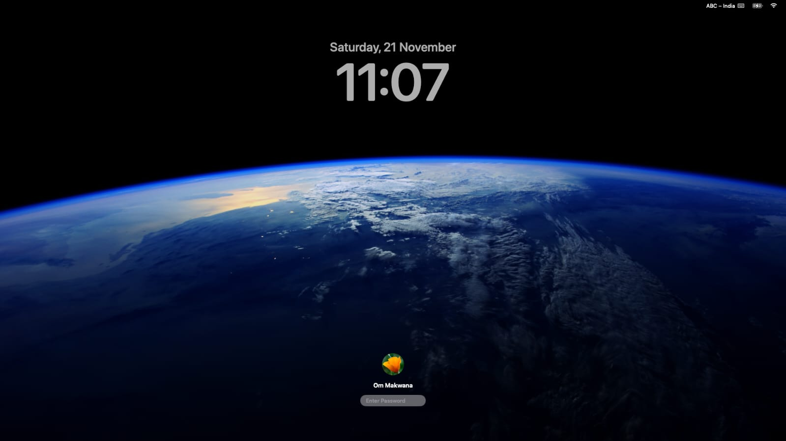
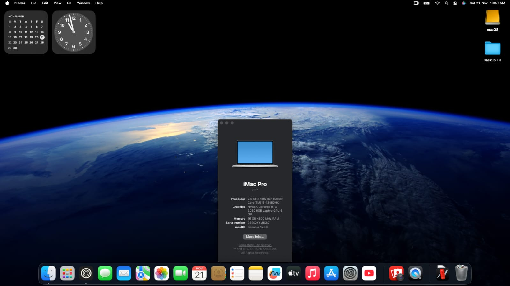

# Lenovo LOQ 15IRX9 — OpenCore Hackintosh EFI

A hardware-specific OpenCore EFI for the **Lenovo LOQ 15IRX9**, running **macOS Sequoia 15.8.3**. This repository is for this exact laptop configuration; it is not a universal EFI for every LOQ variant, BIOS version, or hardware revision.

> **Important:** This is a non-Apple macOS installation. Keep a known-good EFI backup and understand the risks before changing macOS, OpenCore, kexts, ACPI tables, or BIOS settings.

## Hardware

| Component | Details |
|---|---|
| Laptop | Lenovo LOQ 15IRX9 |
| CPU | Intel Core i5-13450HX (13th Gen) |
| Dedicated GPU | NVIDIA GeForce RTX 3050 Laptop GPU, 6 GB VRAM |
| Memory | 16 GB DDR5 4800 MHz |
| Wi-Fi | Realtek RTL8852BE — PCI ID `10EC:B852`, subsystem `17AA:4853` |
| Touchpad | ELAN06FA, I2C |
| SMBIOS configured in EFI | `MacBookPro16,4` |
| macOS | Sequoia 15.8.3 |
| Bootloader | OpenCore |

## Proof

The screenshots below show this EFI booting successfully into macOS Sequoia on the Lenovo LOQ 15IRX9.

| Login screen | macOS desktop / About This Mac |
|---|---|
|  |  |

## Feature status

All items below have been confirmed working by the maintainer on this exact laptop and EFI configuration. Results may differ on another LOQ revision or after firmware, macOS, or driver updates.

### Working

- [x] macOS Sequoia 15.8.3 boot.
- [x] Internal laptop display.
- [x] NVIDIA GeForce RTX 3050 Laptop GPU, 6 GB.
- [x] Internal webcam and microphone.
- [x] Internal audio, headphone jack, and external microphone jack.
- [x] Realtek RTL8852BE Wi-Fi, including scanning, connecting, WPA2/WPA3, roaming, and reconnecting.
- [x] Bluetooth.
- [x] AirDrop, Continuity, Handoff, Universal Clipboard, AirPlay, and Sidecar.
- [x] ELAN06FA I2C touchpad.
- [x] Keyboard, function keys, Lenovo hotkeys, and brightness control.
- [x] Battery status, battery management, and the 80% charge limit.
- [x] Sleep and wake.
- [x] All USB ports, USB-C data, USB-C DisplayPort Alt Mode, and HDMI external display output.
- [x] Ethernet.
- [x] Windows and macOS boot entries.
- [x] Long-duration use and normal macOS update behaviour with this EFI.

## EFI directory structure

```text
EFI/
├── BOOT/
│   └── BOOTx64.efi
└── OC/
    ├── ACPI/
    │   ├── DSDT.aml
    │   ├── SSDT-EC.aml
    │   ├── SSDT-GPI0.aml
    │   ├── SSDT-MCHC.aml
    │   ├── SSDT-PLUG-ALT.aml
    │   ├── SSDT-RTCAWAC.aml
    │   ├── SSDT-SBUS.aml
    │   ├── SSDT-USB-Reset.aml
    │   ├── SSDT-USBX.aml
    │   └── SSDT-XOSI.aml
    ├── Drivers/
    │   ├── HfsPlus.efi
    │   ├── LegionCbmrFix.efi
    │   ├── OpenRuntime.efi
    │   └── ResetNvramEntry.efi
    ├── Kexts/
    │   ├── AirPort_RTW89.kext
    │   ├── AppleALC.kext
    │   ├── BlueToolFixup.kext
    │   ├── BrightnessKeys.kext
    │   ├── CpuTopologyRebuild.kext
    │   ├── Lilu.kext
    │   ├── LOQFanMon.kext
    │   ├── NVMeFix.kext
    │   ├── RealtekBluetoothFirmware.kext
    │   ├── RealtekRTL8111.kext
    │   ├── USBToolBox.kext and UTBMap.kext
    │   ├── VirtualSMC.kext and SMC plugins
    │   ├── VoodooI2C.kext and VoodooI2CHID.kext
    │   ├── VoodooPS2Controller.kext
    │   └── WhateverGreen.kext
    ├── OpenCore.efi
    ├── Resources/
    └── config.plist
```

`SSDT-Disable_Network_RP08.aml`, `UTBDefault.kext`, and the unused PS/2 mouse/trackpad plugin entries are present but disabled in `config.plist`. The enabled state in `config.plist` is authoritative.

## ACPI and drivers

| Component | Purpose in this EFI |
|---|---|
| `DSDT.aml` | Custom DSDT for this laptop's ACPI layout and I2C touchpad path. |
| `SSDT-EC.aml` | Embedded Controller compatibility device. |
| `SSDT-GPI0.aml` | GPIO support used by I2C devices and interrupt handling. |
| `SSDT-PLUG-ALT.aml` | CPU power-management structure. |
| `SSDT-RTCAWAC.aml` | RTC/AWAC compatibility. |
| `SSDT-USB-Reset.aml` and `SSDT-USBX.aml` | USB reset and power properties. |
| `SSDT-XOSI.aml` | ACPI OS-detection method used by this configuration. |
| `HfsPlus.efi` | Reads HFS+ volumes from the OpenCore picker. |
| `OpenRuntime.efi` | OpenCore runtime support. |
| `ResetNvramEntry.efi` | Adds the Reset NVRAM picker entry. |
| `LegionCbmrFix.efi` | Lenovo cloud-recovery/CBMR panic workaround. |

## Main kernel extensions

| Kext | Role |
|---|---|
| `AirPort_RTW89.kext` + `AirPortRTW89Front.kext` | Realtek RTL8852BE Wi-Fi support. |
| `IOSkywalkFamily.kext` + `IO80211FamilyLegacy.kext` | Required networking frameworks for the RTW89 stack. |
| `RealtekBluetoothFirmware.kext` + `BlueToolFixup.kext` | Realtek Bluetooth support. |
| `AppleALC.kext` | Onboard audio patching. |
| `CpuTopologyRebuild.kext` | Hybrid Intel CPU topology compatibility. |
| `Lilu.kext` + `WhateverGreen.kext` | Core patching and graphics compatibility framework. |
| `VirtualSMC.kext` + SMC plugins | SMC emulation, battery, processor, light-sensor, and Super I/O data. |
| `VoodooI2C.kext` + `VoodooI2CHID.kext` | ELAN I2C touchpad support. |
| `VoodooPS2Controller.kext` | Internal keyboard support. |
| `USBToolBox.kext` + `UTBMap.kext` | Machine-specific USB mapping. |
| `RealtekRTL8111.kext` | Realtek Ethernet support. |
| `LOQFanMon.kext` + `YogaSMC.kext` | Lenovo LOQ fan monitoring and laptop integration. |

## Before using this EFI

1. Back up your existing EFI System Partition.
2. Use this EFI only if your hardware is an exact match.
3. Generate your own SMBIOS values before signing in to Apple services. Never reuse someone else's serial number, MLB, system UUID, or ROM.
4. Validate `EFI/OC/config.plist` with the `ocvalidate` release matching OpenCore.
5. Keep a bootable recovery USB or a known-good EFI available before updating macOS, OpenCore, kexts, or BIOS settings.

## Credits

- [OpenCorePkg](https://github.com/acidanthera/OpenCorePkg)
- [Dortania OpenCore Install Guide](https://dortania.github.io/OpenCore-Install-Guide/)
- [VoodooI2C](https://github.com/VoodooI2C/VoodooI2C)
- [USBToolBox](https://github.com/USBToolBox)
- [GenSMBIOS](https://github.com/corpnewt/GenSMBIOS)

## Disclaimer

Use this EFI at your own risk. You are responsible for backing up your data and understanding any changes you make to your computer.
